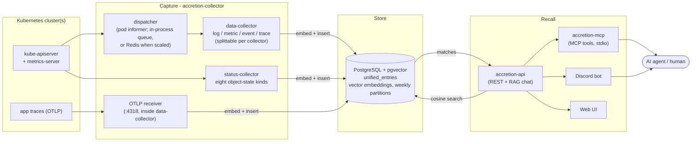

# Accretion

<!-- TOC -->
* [What it is](#what-it-is)
* [What it remembers](#what-it-remembers)
* [Quick Start (local)](#quick-start-local)
  * [Run the stack](#run-the-stack)
  * [Connect an agent](#connect-an-agent)
  * [Watch your own namespace](#watch-your-own-namespace)
* [Connect an agent (MCP)](#connect-an-agent-mcp)
* [How it works](#how-it-works)
* [Components](#components)
* [TLS](#tls)
* [API keys](#api-keys)
  * [Giving someone access](#giving-someone-access)
* [Quick Start (cluster deployment)](#quick-start-cluster-deployment)
  * [The minimal install: what is off, and the one line that turns it back on](#the-minimal-install-what-is-off-and-the-one-line-that-turns-it-back-on)
* [Documentation](#documentation)
* [Key technical facts](#key-technical-facts)
* [Configuration](#configuration)
* [Contributing](#contributing)
* [License](#license)
<!-- TOC -->

> **ac·cre·tion** *n.* — [L. *accretio*, fr. *accrescere* to increase.]
>
> 1. The act of increasing by natural growth; esp. the increase of organic bodies by the internal
>    accession of parts; organic growth.
> 2. The act of increasing, or the matter added, by an accession of parts externally; an extraneous
>    addition.
> 3. Concretion; coherence of separate particles.
>
> — *Webster's Revised Unabridged Dictionary* (1913)

## What it is
**Durable, semantically-searchable memory of your Kubernetes clusters — built for AI agents.**

LLM agents are stateless, with no window into a cluster's operational history. Accretion fills that
gap: it continuously **captures** operational signals from live clusters, **embeds** each one into a
vector, **stores** it in a partitioned pgvector table, and lets an agent **recall** it semantically —
in natural language — through an MCP server or an HTTP API. The result is a queryable record of what
your cluster did and when, long after the events scrolled off `kubectl logs`.

**Grounding is the value proposition** — conditioning an answer on retrieved source data rather than
on training-time memory. Accretion's assistant is prompted to answer only from records it retrieved,
and to reply *"I don't have enough data"* rather than speculate about resources it has no record of.
It's a prompt-level convention, not a hard guarantee — the usual RAG caveats apply — but it keeps
recalled memory anchored to what actually happened instead of to plausible invention.

---

## What it remembers

Everything lands in one `unified_entries` table, tagged by `resource_type`. Fourteen kinds, from a
single log line to a distributed trace:

| `resource_type` | Collector | Captured from |
|---|---|---|
| `log` | `data-collector` | pod logs, dispatched per pod by the controller's Pod informer |
| `metrics` | `data-collector` | pod resource samples; the HPA collector also writes `metrics` |
| `event` | `data-collector` | Kubernetes events, gathered by a self-scheduling poller |
| `trace` | `trace-collector` | the built-in OTLP receiver on `:4318` |
| `pod_status` | `status-collector` | Pod informer |
| `node_status` | `status-collector` | Node informer (cluster-scoped) |
| `deployment_status` | `status-collector` | Deployment informer |
| `hpa_status` | `status-collector` | HorizontalPodAutoscaler informer |
| `endpoint_health` | `status-collector` | EndpointSlice informer |
| `pvc_status` | `status-collector` | PersistentVolumeClaim informer |
| `pv_status` | `status-collector` | PersistentVolume informer (cluster-scoped) |
| `job_status` | `status-collector` | Job informer |
| `cronjob_status` | `status-collector` | CronJob informer |
| `configmap` | `status-collector` | ConfigMap informer — **metadata only**, never `.data` |

Each record keeps its timestamp, namespace, resource name, a JSONB payload with the kind-specific
detail, a SHA-256 content hash for dedup, and a **vector embedding** of a human-readable summary of
the event.

**Kubernetes Secrets are not collected.** Not their values and not their metadata: the chart grants
no verb on them, so cluster secrets stay out of the store entirely. See
[`internal/k8s/statusinformers.go`](internal/k8s/statusinformers.go).

## How it works

Three planes: **capture → store → recall.**



## Quick Start (local)

Runs the full stack on a local [kind](https://kind.sigs.k8s.io/) cluster via
[Tilt](https://tilt.dev/). **Four steps, and this is the whole path.**
[Connect an agent (MCP)](#connect-an-agent-mcp) and
[Quick Start (cluster deployment)](#quick-start-cluster-deployment) carry the alternatives and the
failure modes; go there when something here does not fit.

**Prerequisites:** Go 1.25, Docker, `kind`, `kubectl`, `helm`, `tilt`, `direnv`. This repo is all you
need. [CONTRIBUTING.md](CONTRIBUTING.md#notes-for-linux) covers two Linux-specific gotchas (Docker
group membership and inotify limits for `kind`).

### Run the stack

**1. Clone and bootstrap.**

```bash
git clone git@github.com:autonomousops-co/accretion.git
cd accretion

make bootstrap                    # .env from env.example, Go tools, git hooks, then preflight
```

**2. Fill in `.env`, before `make up`.** `make bootstrap` copies `env.example` to `.env` and stops
there; two of the values it copies are placeholders that halt the stack. Everything below goes in
`.env`, which is gitignored — there is no second file to edit. Non-secret config is checked into
[`.envrc`](.envrc) (direnv), which loads `.env` with `dotenv_if_exists .env`, so a value set in
`.env` also overrides the `.envrc` default of the same name.

| In `.env` | Where it comes from | Needed? |
|---|---|---|
| `SESSION_KEY` | **generate:** `openssl rand -hex 32` | **Required.** `env.example` ships a non-hex placeholder, and `make up` fails at its `sync-secrets` step rather than starting a server that would crashloop. The `32` is a **byte** count — 64 hex characters. |
| `ACCRETION_API_KEY_MCP` | **generate:** `openssl rand -hex 32` | **Required.** Empty on a fresh clone. With no API key set at all, `accretion-api` refuses to render — a deployment that authenticates nobody is a failure here, not a default. |
| `ACCRETION_API_KEY_DISCORD`, `ACCRETION_API_KEY_CI` | **generate,** the same way | Optional — one credential per caller: the Discord bot, and `make test-functional`. |
| `OAUTH_CLIENT_ID`, `OAUTH_CLIENT_SECRET` | **obtain** from Google Cloud | Optional. `env.example`'s placeholders are enough for the pod to start; real values matter only for the web UI, which is off by default. |
| `ACCRETION_AUTH_ALLOWED_EMAILS` | **yours** — your own Google address | Ships `you@example.com`, a reserved address nobody can register, so a bare checkout comes up closed. Set it to log into the web UI. |
| `ACCRETION_LLM_OPENAI_API_KEY`, `ACCRETION_LLM_ANTHROPIC_API_KEY` | **obtain** from the provider | Optional — the default LLM provider is an in-cluster Ollama, which needs no key. |
| `DISCORD_BOT_TOKEN` | **obtain** from Discord | Optional — the bot is off by default. |

[`env.example`](env.example) annotates every variable with the Secret key it becomes, and
`scripts/make-secret.sh --print-keys` prints that list from the script rather than from a doc that
can drift.

**There is one API-key system, and `.env` is its root.** A client sends the plaintext you generated
above; the server compares it against its SHA-256 digest, declared as a `hash` in the chart's
`apiKeys` list. Both halves come from that one `.env` value, through one script:
[`scripts/make-secret.sh`](scripts/make-secret.sh) publishes a Secret holding the plaintext for each
client that runs *in* the cluster — the MCP server and the Discord bot, but not `ci`, which reads
its key from its own environment — and `scripts/make-secret.sh --print-identities` prints the
`apiKeys` block your `.env` implies. Locally the Tiltfile runs that for you and hands the result to
Helm, so you never copy a digest anywhere. [API keys](#api-keys) is the whole mechanism;
[Giving someone access](#giving-someone-access) is how you hand one to a colleague.

**3. Bring it up.**

```bash
direnv allow                      # loads .envrc, which pulls in .env
make up                           # kind cluster + registry, then Tilt builds and deploys everything
```

`make up` takes a few minutes on a cold cache. Watch it at <http://localhost:10350>. Postgres and
the LLM provider need nothing from you: a local Postgres and an in-cluster Ollama are the defaults.

`make up` is just `make kind-up` (the `accretion-dev` cluster + local image registry, and sets
kube-context) followed by `make tilt-up` (builds images and deploys Postgres, the collectors, api,
discord, the otel stack) — run them separately when you want to stop between the two.

`make preflight` re-checks the toolchain at any time, but it does **not** validate `.env`'s
contents: a bad `SESSION_KEY` or a missing API key surfaces later, when Tilt runs
`scripts/make-secret.sh` and Helm renders `accretion-api`. The run/tilt targets do error early with
setup instructions if `.env` is missing entirely.

**4. Check it.** Near the end, `make up` writes the CA that signed the local API certificate to
**`.tls/ca.crt`**, and `.envrc` exports `ACCRETION_API_CA_FILE` pointing at it — which is why `curl`,
the MCP and the functional tests all verify with no certificate placed by hand. [TLS](#tls) has the
rest.

```bash
curl --cacert .tls/ca.crt https://localhost:41337/api/health   # {"status":"ok",...}
open http://localhost:10350                                    # Tilt UI (status, logs)
```

The web UI is **off by default**; the API listener on `41337` is the whole interface. Enable the UI
with `config.ui.enabled` if you want it.

Tear down with `make tilt-down && make kind-down`. `make kind-down` deletes the `accretion-core`
cluster *and* stops the local image registry; `kind delete cluster --name accretion-dev` on its own
leaves the registry container running.

**Build/test without a cluster:**

```bash
go build -mod=vendor ./... && go vet ./... && go test ./...
```

### Connect an agent

`make up` already installed the `accretion-mcp` binary for you (`make tilt-up` depends on
`make install-mcp`, which does `go install ./cmd/accretion-mcp` into `$(go env GOPATH)/bin` — that
directory must be on your `PATH`).

The repo ships [.mcp.json](.mcp.json) (Claude Code) and [opencode.json](opencode.json) (OpenCode)
already pointed at the dev cluster, so **opening the repo in either client is enough** — approve the
server when prompted, then try *"what has my cluster been doing?"*. Both read the API key from the
`accretion-mcp-secrets` Secret that [`scripts/make-secret.sh`](scripts/make-secret.sh) built from
your `.env`, so they need only a kubeconfig pointing at the dev cluster.

Everything else — registering the server globally, pointing it at a cluster you reach over an
ingress, a client the repo ships no config for, or smoke-testing with no client at all — is
[Connect an agent (MCP)](#connect-an-agent-mcp).

### Watch your own namespace

The collectors watch a fixed list of namespaces, and your own workload is not on it. Add it wherever
you deploy from:

| Deployment | Setting |
|---|---|
| Helm values | `config.k8s.namespaces` |
| Helm inline | `--set-json 'config.k8s.namespaces=["default","myapp"]'` |
| Local dev (Tilt) | `ns_monitors` in the [Tiltfile](Tiltfile), or a local `tilt_config.json` |
| Environment | `ACCRETION_K8S_NAMESPACES` (see [.envrc](.envrc)) |
| Hand-written config | `k8s.namespaces` (see [config.example.yaml](config.example.yaml)) |

**Lists are replaced, not merged.**  The last full list of namespaces to monitor overrides the previous ones.

Nothing else needs changing: the collectors bind ClusterRoles, so they can already see any
namespace, and trace scope ships as `"*"` filtered upstream by pod identity. The namespace does not
have to exist yet.

One cost to know: the status collector opens about ten informers per namespace named, and warns at
startup past about twenty. Beyond a handful, prefer `"*"` in `config.namespaces.include`, or a label
selector in `config.namespaces.include_labels` — **not** in `include`, which is name-only: a
selector string there is read as a literal namespace name and silently matches nothing. Either
watches the cluster once. A non-empty `include` also makes `k8s.namespaces` ignored entirely, so
move every namespace across in one go.

**BE SURE NOT TO MONITOR THE ACCRETION-CORE NAMESPACE** or you will create a recursive loop as it monitors itself monitoring itself ... etc

## Connect an agent (MCP)

One stdio MCP server ships with the repo: **`accretion-mcp`**, exposing 13 `accretion_*` tools —
ask, logs, pods, workloads, events, nodes, networking, storage, config, stats, health, traces, and
one trace by id. It is a thin HTTP proxy over `accretion-api` — all retrieval and RAG happen
server-side, so it needs no database access. Full tool reference:
[internal/mcp](internal/mcp/README.md).

**1. Build and install the binary** (Go 1.25; installs to `$(go env GOPATH)/bin`, which must be on
your `PATH`). `make tilt-up` already depends on this target, so after `make up` it is a no-op:

```bash
make install-mcp        # go install ./cmd/accretion-mcp
```

Or build it into `build/` without touching `GOPATH` — then use the absolute path as the command:

```bash
make build-mcp
```

**2. Give it credentials.** `accretion-mcp` resolves exactly two keys, `ACCRETION_API_URL`
(required) and `ACCRETION_API_KEY`. Each has two sources:

| Source | How | When |
|---|---|---|
| Environment | `ACCRETION_API_URL` / `ACCRETION_API_KEY` in the client's `env` block | local dev, remote clusters you reach over an ingress |
| Kubernetes Secret | `ACCRETION_MCP_SECRET_NAME=<namespace>/<name>` | in-cluster, or a workstation with a kubeconfig for the cluster |

With the Secret form, the server reads those same keys out of the Secret's data using in-cluster
config, falling back to your kubeconfig. **Env vars still win** — set one to override a single field
from the Secret (e.g. keep the key in the Secret but point the URL at a port-forward).

The API key must be the plaintext of one of the server's `apiKeys` identities (see
[API keys](#api-keys)). Locally that is your own `ACCRETION_API_KEY_MCP` from `.env`; behind
`make tilt-up`, [`scripts/make-secret.sh`](scripts/make-secret.sh) has already published it into
`accretion-core/accretion-mcp-secrets`, which the checked-in client configs read. To read it back out
of the cluster:

```bash
kubectl -n accretion-core get secret accretion-mcp-secrets \
  -o jsonpath='{.data.ACCRETION_API_KEY}' | base64 -d
```

Auth is enforced locally too, so an omitted or under-scoped key gets a real 401/403.
`ACCRETION_API_URL` is `https://localhost:41337` behind `make tilt-up` or a `kubectl port-forward`,
otherwise your ingress host.

**3a. Claude Code.** The repo already ships a project-scoped [.mcp.json](.mcp.json) — open the repo
in Claude Code and approve the servers when prompted. To register it yourself, or against a
different environment:

```bash
claude mcp add accretion \
  -e ACCRETION_API_URL=https://localhost:41337 \
  -e ACCRETION_API_CA_FILE=/abs/path/to/accretion/.tls/ca.crt \
  -e ACCRETION_API_KEY=<the plaintext of an apiKeys identity> \
  -- accretion-mcp
```

`-s user` makes it available in every project, `-s project` writes it to the shared `.mcp.json`;
the default `local` scope keeps it to you in this project. Check it with `/mcp` inside Claude Code.
The equivalent hand-written config:

```jsonc
{
  "mcpServers": {
    "accretion": {
      "command": "accretion-mcp",
      "env": {
        "ACCRETION_API_URL": "https://localhost:41337",
        "ACCRETION_API_CA_FILE": "/abs/path/to/accretion/.tls/ca.crt",
        "ACCRETION_API_KEY": "<the plaintext of an apiKeys identity>"
      }
    }
  }
}
```

**3b. OpenCode.** The repo ships [opencode.json](opencode.json) for the project; for all projects,
put the same `mcp` block in `~/.config/opencode/opencode.json`. Note the different schema — `command`
is an **array** and the env block is `environment`:

```jsonc
{
  "$schema": "https://opencode.ai/config.json",
  "mcp": {
    "accretion": {
      "type": "local",
      "enabled": true,
      "command": ["accretion-mcp"],
      "environment": {
        "ACCRETION_API_URL": "https://localhost:41337",
        "ACCRETION_API_CA_FILE": "/abs/path/to/accretion/.tls/ca.crt",
        "ACCRETION_API_KEY": "<the plaintext of an apiKeys identity>"
      }
    }
  }
}
```

Both checked-in configs use the Secret form (`ACCRETION_MCP_SECRET_NAME=accretion-core/accretion-mcp-secrets`),
which assumes your kubeconfig points at the dev cluster. That form needs no `ACCRETION_API_CA_FILE`:
the Secret carries a pointer to the CA, and the MCP follows it with the same kubeconfig — nothing to
place by hand, nothing to re-copy when it renews.

That pointer defaults to the serving Secret, which also holds the API listener's **private key** —
Kubernetes RBAC cannot narrow a read to one key of an object, so every MCP user granted it can read
the key too. Where they should not be able to, publish a CA-only ConfigMap (cert-manager's
`trust-manager` does exactly this) and set `ACCRETION_API_CA_CONFIGMAP` in your `.env`;
`scripts/make-secret.sh` writes that pointer into the Secret instead. See
[internal/mcp/README.md](internal/mcp/README.md).

**4. Smoke-test the server** without any client — it should print the 13 tool names:

```bash
printf '%s\n%s\n%s\n' \
  '{"jsonrpc":"2.0","id":1,"method":"initialize","params":{"protocolVersion":"2024-11-05","capabilities":{},"clientInfo":{"name":"t","version":"1"}}}' \
  '{"jsonrpc":"2.0","method":"notifications/initialized"}' \
  '{"jsonrpc":"2.0","id":2,"method":"tools/list"}' \
  | ACCRETION_API_URL=https://localhost:41337 ACCRETION_API_CA_FILE=$PWD/.tls/ca.crt accretion-mcp
```

A missing `ACCRETION_API_URL` exits 1 with a message on stderr — the usual cause of a client showing
the server as "failed to start".

---

- **Capture** — three collector processes turn cluster signals into records: `data-collector`
  (log, metric, event), a split-out `trace-collector` (the OTLP receiver), and `status` (object
  state). Logs and metrics are dispatched per-pod by a controller that watches Pods via a
  client-go informer — in-process at one replica, through Redis under scale-out; events are
  gathered by a self-scheduling poller; resource-status snapshots and configmap/secret changes
  arrive from client-go informers as they happen; traces arrive at the built-in OTLP receiver. Every
  collector embeds each record synchronously (via the configured LLM's embedding model) and inserts
  it. See [internal/worker](internal/worker/README.md).
- **Store** — one `unified_entries` table, `PARTITION BY RANGE (timestamp)` into weekly children,
  with an HNSW cosine index on the embedding and a GIN index on the JSONB. See
  [internal/database](internal/database/README.md).
- **Recall** — an agent asks a natural-language question; it's embedded, the nearest records above a
  similarity threshold are retrieved (optionally within a time window the model extracts from the
  question), and that context is fed to a chat model — classic single-shot RAG. Agents connect over
  MCP; humans use Discord, or the optional web UI (`ui.enabled`, off by default).
  See [internal/mcp](internal/mcp/README.md) and
  [internal/llm](internal/llm/README.md).

## Components

| Binary / process | Role |
|---|---|
| `accretion-api` | One binary, many cobra subcommands: the REST/RAG **`server`**, the **`data-collector`** (log, metric, event, trace), the **`status`** collector (object state), the **`collector`** controller (scale-out only), the **`discord`** bot, plus **`healthcheck`** and **`generate config`** |
| `accretion-mcp` | MCP server (stdio) exposing the `accretion_*` tools; a thin HTTP proxy to `accretion-api` |

---

## TLS

The API listener terminates TLS **in the process**, not at a proxy. `api.tls.enabled` defaults to
true, so `https://localhost:41337` is the address in every example above.

This replaces terminating at a GCE Ingress, which was GCP-specific and decrypted at the load
balancer — everything from there inward (LB → Service → pod) was plaintext, and locally there was no
TLS at all. A sidecar or service mesh was set aside: a proxy per pod and an operator to run, for a
service that already authenticates every request by bearer key.

**Locally, there is nothing to set up.** `make up` installs cert-manager, which issues a certificate
from a self-signed CA, and Tilt writes that CA to `.tls/ca.crt`. `.envrc` exports
`ACCRETION_API_CA_FILE` pointing at it, so `curl`, the MCP, the functional tests and `preflight`
all verify with no further steps. The certificate's SANs cover the in-cluster Service DNS **and**
`localhost` **and** `127.0.0.1` — the loopback names matter, because every local client reaches the
API through a port-forward.

**In a cluster**, either let cert-manager issue it:

```bash
helm install accretion-api ./charts/accretion-api -n accretion \
  --set config.api.tls.enabled=true \
  --set config.api.tls.certManager.enabled=true \
  --set-json 'apiKeys=[{"name":"accretion-mcp","hash":"<digest>","permissions":["read:memory","chat:query"]}]'
```

The identity is not a TLS setting; it is there because the chart refuses to render an authenticated
deployment with none, so the command fails without one. See [API keys](#api-keys) for how to produce
the digest.

or bring a Secret you already hold, with `config.api.tls.existingSecret=<name>` (it needs `tls.crt`
and `tls.key`, plus `ca.crt` if the issuer is private). `existingSecret` **takes precedence** — set
it and the chart issues nothing, whatever `certManager.enabled` says. Set
`config.api.tls.certManager.issuerRef` to issue from an issuer you already run — Let's Encrypt, say —
and the chart creates no issuers of its own.

Two things fail deliberately rather than degrading:

- **The server never falls back to cleartext.** TLS enabled with a keypair it cannot load is a
  startup error, so a certificate problem is a crash you can see rather than an unencrypted
  listener you cannot.
- **Nothing skips verification.** `insecure_skip_verify` exists on the clients but is *refused* for
  any non-loopback host, and logged loudly where it is allowed. An unconstrained escape hatch is the
  setting everyone copies out of a README, and the result is a stack that reports TLS everywhere and
  verifies nothing.

To turn it off — for an environment terminating TLS elsewhere — set `config.api.tls.enabled=false`
and use `http://` URLs.

## API keys

An **Accretion API key** is a bearer token a non-browser client — `accretion-mcp`, the Discord bot,
`curl`, CI — presents to `accretion-api` as `Authorization: Bearer <key>`. It's the machine
counterpart to the Google OAuth session cookie humans get from the web UI. There is no registration
endpoint and no database table: a key is a random string, and the server stores only its SHA-256
digest.

Every key belongs to **one named identity with its own permissions**. There is no shared key — one
compromised laptop is revoked by deleting one entry, and each request is attributable to the client
that made it. Auth is **on by default**, including in the Tilt/kind stack.

**1. Declare an identity per client** in the chart's `apiKeys` values list, as a `hash` — the hex
SHA-256 of the key, so the plaintext never enters the Helm release. The chart also accepts `key`,
the plaintext, and derives the digest itself; `security.forbidPlaintextAPIKeys` refuses that by
default and no values file here turns it off, so every path including local development is hash-only
and each client's plaintext lives in your gitignored `.env`:

```yaml
apiKeys:
  - name: accretion-mcp
    hash: "<hex sha256 of the key>"
    permissions: ["read:memory", "chat:query"]
  - name: ci
    hash: "<hex sha256 of another key>"
    permissions: ["read:memory"]        # read-only: /api/chat 403s
```

Generate a key and its digest — Helm's `sha256sum` produces exactly this value, so a `key` entry
needs no hand-copied digest:

```bash
KEY=$(openssl rand -hex 32)
printf '%s' "$KEY" | pbcopy              # or: xclip -selection clipboard / wl-copy
printf '%s' "$KEY" | shasum -a 256       # or: sha256sum
```

The plaintext goes to the clipboard rather than to your scrollback. It is a password: paste it
straight into the client config or a password manager, and keep it out of terminal buffers, shell
history and anything recording your session. Only the digest on the second line is safe to leave
lying around.

`permissions` is matched exactly, with no hierarchy — `admin:all` does **not** imply `read:memory`.
The routes require `read:memory` and `chat:query`. Give a client only what it calls: a read-only
key that can't reach `/api/chat` can't spend LLM tokens.

The chart renders each identity into `auth.api_key_identities` in the mounted `config.yaml`, and
**fails to render** if authentication is enabled with no identities, or if an entry has no
permissions (it would authenticate and then 403 everywhere).

> **Breaking change in chart 0.2.0 (existing installs).** `security.forbidPlaintextAPIKeys` now
> defaults to `true`. A values file that declares an `apiKeys` entry with `key` (plaintext) and does
> not itself set this flag — previously fine, since the old default was `false` — now fails to
> render, naming the entry and `security.forbidPlaintextAPIKeys` as the value to change. Switch the
> entry to `hash`, as every values file here now does, `values-dev.yaml` included — or, if a
> checked-in plaintext key really is intentional in yours, add
> `security.forbidPlaintextAPIKeys: false` and say why.

**2. Give each client its own key.** Because every identity is `hash`-only, the chart has no
plaintext to publish and never sees one. [`scripts/make-secret.sh`](scripts/make-secret.sh) is the
single mapping from `.env` to both halves: `--print-identities` emits the `apiKeys` block your
`.env` implies, and the script publishes each client's own plaintext in its own Secret —
`accretion-mcp-secrets` (`ACCRETION_API_URL` / `ACCRETION_API_KEY`) for the MCP servers, and
`accretion-discord-secrets` (`api-key-accretion-discord`) for the bot, which its chart's
`api.secretName` / `api.secretKey` are pointed at. For a client outside the cluster, distribute the
plaintext out-of-band; see [Giving someone access](#giving-someone-access).

```bash
curl --cacert .tls/ca.crt -H "Authorization: Bearer <key>" https://localhost:41337/api/stats
```

The hash and the plaintext are two inputs now, where the chart once derived both from one, and they
can disagree — with a bare 401 as the only symptom. That is gated rather than commented: `make
secrets` refuses to create either Secret unless every identity's hash is the digest of its plaintext
in `.env`, and `make secrets-identity-check` proves that refusal fires.

**3. Rotating a key** is add → roll → delete, with no flag day, because identities are independent:

1. Add a second entry for the same client (`accretion-mcp-2`) with the new digest and the same
   permissions, and apply the chart. Both keys are now accepted.
2. Point that one client at the new key and confirm it works.
3. Delete the old entry and apply again. The old key is now dead.

Two things to expect while rotating:

- **In-cluster clients need a restart to pick up a new key.** `secretKeyRef` env vars are resolved
  once at container start and never refresh, and the Discord bot's pod annotation tracks its own
  chart — so a server-side rotation leaves it retrying with the stale key until you restart it:

  ```bash
  kubectl rollout restart deployment/accretion-discord -n accretion
  ```

- **Each apply rolls the API pods.** Identities live in the ConfigMap, which the Deployment hashes
  into its `checksum/config` annotation, so steps 1 and 3 are two rollouts. That is what makes the
  change take effect without a restart flag — but a rotation is two rolling restarts of
  `accretion-api`, so do it off-peak.

> **Key names matter for the *other* Secret.** `accretion-api-secrets` holds the OAuth and session
> material, and its keys are dashed-lowercase, *not* the `.env` variable names — so
> `kubectl create secret --from-env-file=.env` populates a Secret the chart won't read, and the only
> symptom is a 401 on every request. Use `scripts/make-secret.sh` (or `make secrets`), which is the
> one mapping, and `make secrets-check` to prove the keys match.
>
> The rule: Secret keys are the dashed-lowercase form of the `.env` variable name
> (`ACCRETION_AUTH_ADMIN_EMAILS` -> `accretion-auth-admin-emails`). For the current list, ask the
> script rather than a doc:
>
> ```bash
> scripts/make-secret.sh --print-keys
> ```
>
> `session-key`, `oauth-client-id`, and `oauth-client-secret` are **not** `optional: true`: a
> missing value fails the pod at rollout rather than 401ing every request afterwards. The script
> refuses to build a Secret without them.
>
> **At least one of the four whitelist keys is required too.** An empty whitelist means "allow every
> authenticated user", so with OAuth configured and no lists set, any Google account on the internet
> that completes the flow would get `read:memory` + `chat:query`. The server refuses to start in
> that state rather than come up silently open — the check is in `NewAuthManager`, so it holds no
> matter how the Secret was created.

See [internal/server](internal/server/README.md#authentication--authorization-auth) for the
full matching order.

### Giving someone access

A colleague running `accretion-mcp` on their own machine needs no cluster access, no kubeconfig,
and no OAuth account. They need two values from you, and you are the only source of one of them.

**1. Mint a key and record only its digest.** This is your only chance to see the plaintext — the
cluster stores the SHA-256, so nobody, including you, can recover it later. A lost key is replaced,
not retrieved.

```bash
KEY=$(openssl rand -hex 32)
printf '%s' "$KEY" | pbcopy                       # send THIS to them, out-of-band
printf '%s' "$KEY" | shasum -a 256                # the digest — step 2 says where it goes
```

`pbcopy` is macOS; use `xclip -selection clipboard` or `wl-copy` on Linux. The clipboard, not your
scrollback, is deliberate — you are handling someone else's credential, so treat it like any other
password: out-of-band to them, and never into a terminal buffer, a chat log or a ticket. If you do
print it, clear the buffer afterwards and assume your shell history saw it too.

**2. Add an identity for that person,** as an entry in the `apiKeys` list of the values the
`accretion-api` release is installed from. One entry per caller, never a shared key: that is what
lets you revoke theirs without disturbing anyone else.

```yaml
apiKeys:
  - name: alice-laptop
    hash: "<the digest from step 1>"
    permissions: ["read:memory", "chat:query"]
```

**Which file that is depends on how you install**, and there are four answers:

| Install path | Where the digest goes |
|---|---|
| A cluster you install by hand | Your own values file, passed with `-f` — or skip the file entirely and use `--set-json`, below |
| This repo, `make up` / Tilt | **Nowhere.** The Tiltfile derives every digest from your `.env` with `scripts/make-secret.sh --print-identities` and passes them as `--set-json`. Put the plaintext in `.env` and you are done |
| This repo, `make deploy-auth STACK=dev` | [`charts/accretion-api/values-dev.yaml`](charts/accretion-api/values-dev.yaml) — the file `IDENTITIES_FILE` names in the [Makefile](Makefile), and the one `make secrets` checks your digests against `.env` before it creates any Secret |
| Pulumi | [`deploy/pulumi.yaml`](deploy/pulumi.yaml) carries the **name and permissions only**; the digest is stack config — `pulumi config set --stack <stack> --secret --path 'apiKeyHashes.alice-laptop' <digest>`. A digest written into that checked-in file is refused, not merged |

> **Editing anything under `charts/accretion-api/` needs a `Chart.yaml` version bump.** A pre-commit
> hook ([`scripts/check-chart-version-bump.sh`](scripts/check-chart-version-bump.sh)) refuses the
> commit otherwise, because Helm keys its chart cache on the chart `version`: reinstalling an edited
> chart under the version it already had is a no-op against a warm cache, the release keeps serving
> the old manifests, and nothing reports an error. The symptom would be an identity you added that
> never authenticates.

**3. Apply it.** Either pass your values file, or inline the whole list — `--set-json` takes
precedence over `-f`, so an inline list **replaces** the file's rather than adding to it, and must
name every identity you want to keep:

```bash
# from a values file
helm upgrade --install accretion-api ./charts/accretion-api \
  --namespace accretion \
  --values my-values.yaml

# or inline, naming every caller including the ones that already worked
helm upgrade --install accretion-api ./charts/accretion-api \
  --namespace accretion \
  --set-json 'apiKeys=[
    {"name":"accretion-mcp","hash":"<digest>","permissions":["read:memory","chat:query"]},
    {"name":"alice-laptop","hash":"<the digest from step 1>","permissions":["read:memory","chat:query"]}
  ]'
```

The apply rolls the `accretion-api` pods: identities live in the ConfigMap, which the Deployment
hashes into its `checksum/config` annotation. That is what makes the new key work without a restart
flag — [API keys](#api-keys) uses the same mechanism to rotate a key with no flag day.

Give **both** permissions unless you mean to withhold one. `read:memory` unlocks twelve of the
thirteen tools; `chat:query` unlocks `accretion_ask` alone. A key with only `read:memory` gives them
twelve working tools and a 403 from the question-answering one, which reads as a bug rather than a
decision.

**4. Send them the URL and the key.** The URL is whatever address reaches your API listener from
outside the cluster — your ingress hostname, or a tunnel you have set up. It is not
`localhost:41337` unless they are running their own port-forward, which needs the cluster access
they do not have.

**5. Tell them what to do with it.** They build the binary (`go build -o accretion-mcp
./cmd/accretion-mcp`) and add one block to their client config:

```json
{
  "mcpServers": {
    "accretion": {
      "command": "/path/to/accretion-mcp",
      "env": {
        "ACCRETION_API_URL": "https://accretion.example.com",
        "ACCRETION_API_KEY": "<the key from step 1>"
      }
    }
  }
}
```

For opencode the schema differs — `command` is an array and the block is `environment`; see
[Connect an agent (MCP)](#connect-an-agent-mcp) for that form and for the
`ACCRETION_MCP_SECRET_NAME` alternative, which suits colleagues who *do* have kubectl access.

> Local development follows this same workflow — there is no shortcut to fall back on.
> `values-dev.yaml` declares `apiKeys: []` exactly as staging and prod do, and the dev plaintexts
> live in your gitignored `.env` like every other secret. `make values-check` refuses a plaintext
> key in *any* checked-in values file, and proves that refusal fires against a purpose-built
> fixture rather than asserting it.

---

## Quick Start (cluster deployment)

Installs **only Accretion** — no Tilt, no kind — into an existing
Kubernetes cluster with Helm. Charts live in [`charts/`](charts/README.md); see
[charts/README.md](charts/README.md) for what each one deploys.

**Prerequisites:** `kubectl` pointed at the target cluster, `helm` 3.x, and a container registry the
cluster can pull from. The images aren't published yet, so build and push them yourself:

```bash
docker build -t <registry>/accretion-api:<tag> .
docker push <registry>/accretion-api:<tag>
```

Every chart uses the same `accretion-api` image (one binary, different subcommands).

**1. Namespaces and secrets.** Postgres runs in its own namespace; the app components share one:

```bash
kubectl create namespace accretion-db
kubectl create namespace accretion

# Fill in a .env first (cp env.example .env), then let the script build the Secrets:
scripts/make-secret.sh --namespace accretion
```

Use the script rather than creating them by hand. It is the one mapping from `.env`'s SHELL_CASE
variable names to the charts' dashed key names, and it refuses to build a Secret that is missing a
required key or a user whitelist — both of which fail only at rollout, or silently, if you assemble
the `--from-literal` list yourself. `scripts/make-secret.sh --print-keys` lists the keys it emits,
`--dry-run` prints the manifest without applying it, and [API keys](#api-keys) explains why a
key-name mismatch fails silently.

It emits **up to three** Secrets, one per consumer: `accretion-api-secrets` (the server's own key
material), `accretion-mcp-secrets` (the MCP client's credential, plus a pointer to the API's CA) and
`accretion-discord-secrets` (the bot's own credential for `accretion-api`). A consumer whose key is
unset in `.env` is **skipped**, with a note on stderr naming the Secret, the variable and what will
fail without it — so following the table in [Run the stack](#run-the-stack), which leaves the
Discord key optional, you get two. What is *not* in any of them is the server's side of an API key:
that is the SHA-256 `hash` in the chart's `apiKeys` values list, and
`scripts/make-secret.sh --print-identities` prints the block your `.env` implies.

**2. Database (PostgreSQL + pgvector + schema).** The chart pulls in the Bitnami PostgreSQL
subchart, so resolve dependencies first; a post-install Job applies `unified_entries` and its
indexes:

The chart carries **no password of its own**. It shipped `postgres` for both the superuser and its
own schema Job until #134 — a working credential in a public repository — and now refuses to render
with neither a password nor a Secret named. Create the Secret first; both keys hold the same value,
because two readers name it differently (`postgres-password` is what the Bitnami subchart's
`auth.secretKeys.adminPasswordKey` reads, `db-password` is what the schema Job and the partition
CronJob read through `secretKeyRef`):

```bash
kubectl create namespace accretion-db
kubectl create secret generic accretion-db-secrets -n accretion-db \
  --from-literal=postgres-password=<db-password> \
  --from-literal=db-password=<db-password>

helm dependency build ./charts/accretion-db
helm upgrade --install accretion-db ./charts/accretion-db \
  --namespace accretion-db \
  --set postgresql.auth.existingSecret=accretion-db-secrets \
  --set config.database.existingSecret=accretion-db-secrets \
  --wait

kubectl wait --for=condition=complete job/accretion-db-schema -n accretion-db --timeout=300s
```

Locally, `scripts/make-secret.sh` builds exactly that Secret from `ACCRETION_DATABASE_PASSWORD` in
your gitignored `.env`, so `make up` needs none of this by hand.

`--set-string postgresql.auth.postgresPassword=<db-password> --set-string
config.database.password=<db-password>` also renders, and is the shortcut the chart still accepts;
it puts the value in your shell history and in the Helm release, where `helm get values` returns it
in cleartext. Prefer the Secret.

**3. Collectors** (three pods by default):

The collectors run as three Deployments. `-data-collector` runs the log, metric and event
collectors; `-trace-collector` runs the OTLP trace receiver on its own, so the one unauthenticated
listener never shares an identity with the log collector's cluster-wide `pods/log` grant; and
`-status-collector` runs the eight object-state collectors (pod, node, deployment, PVC, HPA, job,
configmap, endpoint health). Each has its own `image.*` block — there is no global one:

```bash
IMAGES=""
for w in collector dataCollector statusCollector; do
  IMAGES="$IMAGES --set $w.image.repository=<registry>/accretion-api --set $w.image.tag=<tag>"
done

helm upgrade --install accretion-collector ./charts/accretion-collector \
  --namespace accretion \
  $IMAGES \
  --set config.database.host=accretion-db-postgresql.accretion-db.svc.cluster.local \
  --set-string config.database.password=<db-password> \
  --set-string config.database.sslmode=require \
  --set-json 'config.k8s.namespaces=["accretion","default"]'
```

`config.k8s.namespaces` is the list of namespaces the collectors watch, under the same rule
[Watch your own namespace](#watch-your-own-namespace) states for local development: **lists are
replaced, not merged**, so name every namespace you want watched in one go. That section also has
the informer cost per namespace and the `config.namespaces.include` selector that supersedes this
list entirely.

**This chart ships no per-environment values file.** Its `values-dev`, `values-test`,
`values-staging` and `values-prod` files were retired: they had become a third overlay surface
nothing automated read, and one of them also carried a working Redis password. What you get above is
chart defaults plus these flags — the single-replica shape the rest of this section describes;
scale-out is opt-in below.

Two consequences are worth naming, because Helm reports neither:

- **`config.database.sslmode` defaults to `disable`.** The retired staging and prod files were where
  `require` lived, so a command that merely drops the `--values` line quietly deploys collectors
  talking to Postgres in the clear. Name it, as above. `make deploy-collector` names it for you and
  refuses anything weaker than `require`, `verify-ca` or `verify-full` outside `dev` and `test`.
- **Sizing, autoscaling and PodDisruptionBudgets are yours to supply.** Write your own overlay and
  pass it through the guarded path — `make deploy-collector STACK=prod COLLECTOR_VALUES="-f
  my-prod.yaml"`, which renders it first and refuses a file that does not render or that would send
  production database traffic unencrypted. `make deploy-collector` with no such file refuses outside
  `dev`/`test` rather than installing bare defaults under a production name.
  [`deploy/pulumi.yaml`](deploy/pulumi.yaml) is the worked example: it is what the Pulumi path
  layers on this chart, and its `accretion-collector` subtree is a good starting shape.

**Don't pass the database or Redis password to Helm at all — and since #134 the database one is no
longer optional to think about.** The chart carried `postgres` as its own default until then and now
carries nothing, so a render with neither a password nor an `existingSecret` fails and names both.
`--set-string config.database.password=<value>` above satisfies it, and is what the local stack is
deliberately moving away from: it puts the value in shell history and in the Helm release Secret,
where `helm get values` returns it in cleartext (the same shape `charts/DKJR.md` warns about for a
different key). Create the Secret out of band instead — a plain `kubectl create secret generic`,
External Secrets Operator, Vault, or SOPS — and point the chart at it by name:

```bash
kubectl create secret generic accretion-db-creds -n accretion \
  --from-literal=password=<db-password>
kubectl create secret generic accretion-redis-creds -n accretion \
  --from-literal=password=<redis-password> \
  --from-literal=redis.conf="requirepass \"<redis-password>\""

helm upgrade --install accretion-collector ./charts/accretion-collector \
  --namespace accretion \
  $IMAGES \
  --set config.database.host=accretion-db-postgresql.accretion-db.svc.cluster.local \
  --set config.database.existingSecret=accretion-db-creds \
  --set redis.auth.existingSecret=accretion-redis-creds \
  --set-string config.database.sslmode=require \
  --set-json 'config.k8s.namespaces=["accretion","default"]'
```

`sslmode` is named here for the same reason as above: the chart's default is `disable`, and no
values file supplies otherwise any more. `existingSecret` moves the *password* out of Helm's reach,
not the TLS mode.

The Redis Secret needs **both** keys shown above: `password` (every client reads it via
`secretKeyRef`) and `redis.conf` (the literal `requirepass "<password>"` directive, mounted as a
file, because `redis-server` has no env-var form of `requirepass`). If the password itself contains
a `"` or a `\`, escape it inside that directive (`\"` / `\\`) — the chart does this for you with Go's
`%q` on the chart-owned path, but here you own the encoding, and an unescaped quote or backslash
breaks the directive rather than becoming part of the password. Keep the two keys in sync, or
clients and the server authenticate with different passwords; a Secret with only `password` renders
fine and fails at rollout, on the Redis pod's volume mount. See the `existingSecret` /
`existingSecretKey` / `existingSecretPasswordKey` / `existingSecretConfKey` comments in
`charts/accretion-collector/values.yaml` for the full tradeoff — including which validation moves
to the operator once the chart stops seeing the value. Leaving both `existingSecret` values unset
keeps the chart managing its own Secrets from `config.database.password` / `redis.auth.password` —
but neither has a default any more, so that path means supplying both values, not inheriting them.

**No controller and no Redis are deployed here.** They shard work across horizontally scaled
collectors, and a default install runs one replica of each with no HPA — so the dispatcher runs
inside the collector process and hands work to its own collectors directly. Scaling any collector
brings them back automatically; there is no separate flag:

```bash
--set dataCollector.replicaCount=3          # scales the shared process, controller + Redis return
```

To scale one collector on its own, split it into its own Deployment:

```bash
--set dataCollector.kinds.log.split=true --set dataCollector.kinds.log.replicaCount=3
```

Every collector is also individually switchable — `dataCollector.kinds.<log|metric|event|trace>.enabled`
and `statusCollector.kinds.<name>.enabled`. Turning a kind off also drops its RBAC rule.

**Upgrading from a release before the consolidation (chart < 0.1.5):** the `-trace-worker` Service
keeps its name — the OTel collector exports to it at a fixed address — but its selector moves once,
from the old `trace-worker` component label to `accretion.io/collects-traces="true"`, which lets the
trace receiver live in whichever Deployment carries it. During that upgrade the old `trace-worker`
pods are gone and the new `-trace-collector` pods are not yet ready, so OTLP ingest has no endpoint
for that window; the OTel collector's exporter retries with backoff, which covers a short gap but
not a long one. Upgrade the collector chart before, not during, anything you want traced. In prod
and staging the receiver runs 2 replicas behind an HPA and a PDB, so later rollouts are unaffected.

### The minimal install: what is off, and the one line that turns it back on

A minimal install deploys only what an accretion feature depends on. Everything below works when
enabled, but none of it is deployed unless you ask.

| Off by default | What it is | Turn it on with |
| --- | --- | --- |
| Collector controller + Redis | Shards work across scaled collectors | `--set dataCollector.replicaCount=3` (any scale-out) |
| Discord bot | One of three front ends | `--set enabled=true --set secret.botToken=<token>` |
| Grafana | Dashboards | `--set grafana.enabled=true` (needs a backend below) |
| Loki | Log storage for Grafana | `--set loki.enabled=true --set-json 'config.service.pipelines.logs.exporters=["debug","otlphttp/loki"]'` |
| Prometheus | Metric storage for Grafana | `--set prometheus.enabled=true --set-json 'config.service.pipelines.metrics.exporters=["debug","prometheus"]'` |

Loki and Prometheus take two settings, not one: deploying a backend is one change, feeding it is
another. The minimal profile's `logs` and `metrics` pipelines export to `debug` only, so a backend
enabled without its exporter would come up and receive nothing. The chart refuses that render in
**both** directions — an exporter naming a backend that is not deployed, and a backend deployed with
no pipeline feeding it — so a wrong combination is a failed `helm upgrade` naming the missing line,
never a stack that comes up quiet and empty.

Tempo stays on: it is the only part of the observability stack an accretion feature depends on,
backing `/api/traces` and `/api/traces/{id}`. Grafana, Loki and Prometheus are developer
conveniences nothing in accretion reads from. Grafana is the exception to the two-setting rule — it
reads from the others rather than from the collector, so it needs no pipeline, but the chart refuses
to deploy it with no backend at all to read.

Deploy the observability stack with the minimal profile:

```bash
helm upgrade --install otel-collector ./charts/otel-collector \
  --namespace obs -f charts/otel-collector/values-minimal.yaml
```

That is the OTel collector plus Tempo — 2 pods instead of 5.

`make up` for a contributor still brings up the **full** stack, Grafana included — the minimal
profile is for operators, not for local development.

**4. API / RAG server** — `ollama.enabled=false` means recall uses whatever LLM provider you
configure instead of an in-cluster Ollama.
`postgresql.enabled=false` tells the chart Postgres lives elsewhere (the `accretion-db` release
above), and `ingress.managedCertificate.enabled=false` skips the GKE-only `ManagedCertificate`
object — leave it on only for GKE. `ollama.multiZone.enabled=false` drops the GKE zone-discovery
placeholder Services, which the chart renders by default even when Ollama itself is off:

```bash
helm upgrade --install accretion-api ./charts/accretion-api \
  --namespace accretion \
  --values charts/accretion-api/values-prod.yaml \
  --set image.repository=<registry>/accretion-api \
  --set image.tag=<tag> \
  --set ollama.enabled=false \
  --set ollama.multiZone.enabled=false \
  --set postgresql.enabled=false \
  --set ingress.managedCertificate.enabled=false \
  --set config.database.host=accretion-db-postgresql.accretion-db.svc.cluster.local \
  --set-string config.database.password=<db-password> \
  --set ingress.enabled=true \
  --set ingress.className=nginx \
  --set-json 'ingress.hosts=[{"host":"accretion.example.com","paths":[{"path":"/","pathType":"Prefix"}]}]' \
  --set-json 'apiKeys=[
    {"name":"accretion-mcp","hash":"<digest>","permissions":["read:memory","chat:query"]},
    {"name":"accretion-discord","hash":"<digest>","permissions":["read:memory","chat:query"]}
  ]'
```

`apiKeys` is required: the chart refuses to render an authenticated deployment with no identities
(see [API keys](#api-keys) for how to produce each `<digest>`). Prod entries carry `hash` only, so
no plaintext enters the Helm release — distribute each client's key out-of-band.

The DB password has no chart default (#134): the render above fails without either
`--set-string config.database.password=<db-password>`, as shown, or a Secret. Prefer the Secret —
put the password in an operator-managed one under a `db-password` key and pass
`--set config.database.existingSecret=<name>` instead, which keeps the value out of your shell
history and out of `helm get values`. `deploy/pulumi.yaml` points this chart at
`accretion-api-secrets`, and `scripts/make-secret.sh` builds the same Secret locally.

**5. (Optional) Discord bot.** Off by default: the MCP is the primary front end, and the bot needs a
token you may not have. `--set enabled=true` is what turns it on.

> **Breaking change in chart 0.3.0 (existing installs).** `enabled` defaults to `false`, and a
> values file written before the key existed cannot contain it — so `helm upgrade` with your current
> values renders nothing, and Helm deletes the bot's Deployment, Secret, ServiceAccount and
> ConfigMap with exit 0 and no warning. Add `enabled: true` to your values file, or pass
> `--set enabled=true`, before upgrading. If it has already happened, `helm rollback accretion-discord`
> restores the release; the bot token survives in release history.

```bash
helm upgrade --install accretion-discord ./charts/accretion-discord \
  --namespace accretion \
  --set enabled=true \
  --set image.repository=<registry>/accretion-api \
  --set image.tag=<tag> \
  --set secret.botToken=<discord-bot-token> \
  --set api.secretName=accretion-discord-secrets \
  --set api.secretKey=api-key-accretion-discord
```

No database host here, unlike every other chart: the bot holds no database connection. It routes
every cluster query through `accretion-api`, so there is a single auth-enforced data path. The chart
declares no `config.database` at all — Helm accepts an unknown value key and ignores it, so a flag
setting one would have looked like configuration and been none.

The last two lines are there because the bot reads its own key for `accretion-api` from
`api.secretName` / `api.secretKey`. They still *default* to an entry in `accretion-api`'s
`accretion-api-client-keys` Secret, which that chart renders only for an identity declaring a
plaintext key — and every identity is `hash`-only now, so nothing renders it. The values above name
the Secret `scripts/make-secret.sh` builds from `.env` instead, which is what the Tilt and Pulumi
paths use too, so the bot is pointed at one shape everywhere. The reference is deliberately **not**
optional: a wrong or missing Secret fails the pod at rollout instead of 401ing every call.

**6. Verify:**

```bash
kubectl get pods -n accretion
kubectl port-forward -n accretion svc/accretion-api 41337:80
kubectl get secret accretion-api-tls -n accretion -o jsonpath='{.data.ca\.crt}' | base64 -d > ca.crt
curl --cacert ca.crt https://localhost:41337/api/health   # {"status":"ok",...}
```

Uninstall with `helm uninstall accretion-api accretion-discord accretion-collector -n accretion` and
`helm uninstall accretion-db -n accretion-db` (the Postgres PVC survives; delete it separately).

---

## Documentation

| Area | Doc |
|---|---|
| Codebase & architecture map | [ARCHITECTURE.md](ARCHITECTURE.md) |
| The memory store (schema, pgvector, RAG search) | [internal/database/README.md](internal/database/README.md) |
| Ingestion pipeline (collector, workers, queue) | [internal/worker/README.md](internal/worker/README.md) |
| Agent access (MCP tools) | [internal/mcp/README.md](internal/mcp/README.md) |
| Recall & reasoning (embeddings, providers, RAG) | [internal/llm/README.md](internal/llm/README.md) |
| HTTP API & auth | [internal/server/README.md](internal/server/README.md) |
| Deployment (Helm, Tilt, kind) | [charts/README.md](charts/README.md) |
| Storage partitioning & retention | [charts/accretion-db/PARTITIONING.md](charts/accretion-db/PARTITIONING.md) |
| DKJR chaos generator (dev fixture, installed on demand) | [charts/DKJR.md](charts/DKJR.md) |
| Cloud infrastructure (GCP/GKE, Pulumi) | [pulumi/README.md](pulumi/README.md) |

## Key technical facts

- **Store:** PostgreSQL + [pgvector](https://github.com/pgvector/pgvector). One `unified_entries`
  table, `vector` embeddings, HNSW index with `vector_cosine_ops`, GIN index on JSONB, weekly
  range partitions with automated create-ahead + retention.
- **Recall:** cosine similarity via the `<=>` operator; `similarity = 1 - (embedding <=> query)`
  with a hard `0.3` minimum; top-10 fetched, top-5 rendered into LLM context.
- **Embeddings:** the embedding model (default `nomic-embed-text:latest`) sets the vector width, and
  the pgvector column is declared to match it. Anthropic has no embeddings API, so it delegates
  embedding to Ollama.
- **LLM providers:** `ollama` (default), `openai`, `anthropic` — each with native support for the
  agentic tool-use loop (the Discord bot fetches its own data across up to 10 tool rounds), with a
  prompt-based ReAct fallback so any other Chat-only provider can drive the loop too.
- **Ingest resilience:** every embed and insert is wrapped in a per-worker circuit breaker
  (5 failures → open) over exponential-backoff retry, so a failing LLM endpoint trips independently
  of the database.
- **Self-ingestion guard:** accretion's own namespace is excluded from the log/trace scope so it
  doesn't record (and re-embed) its own output in a loop.

## Configuration

Config is [viper](https://github.com/spf13/viper)-based with the env prefix `ACCRETION_` (e.g.
`ACCRETION_DATABASE_HOST`, `ACCRETION_LLM_PROVIDER`).

**The web UI is off by default.** Accretion's primary interfaces are `accretion-mcp` and the Discord
bot, both of which authenticate by API key, so the default deployment serves only `/api/*` plus
`/api/health` — no browser reachability, no OAuth client, no user whitelist. Set `ui.enabled: true`
(chart: `config.ui.enabled`) to serve the web interface; that deployment then also needs
`auth.oauth.*` configured and at least one entry in the user whitelist. Locally these come from
`.envrc`/`.env`; in the cluster, from Helm values and Kubernetes Secrets. A commented reference
config lives in [config.example.yaml](config.example.yaml).

## Contributing

See [CONTRIBUTING.md](CONTRIBUTING.md) for the development setup, the checks a change has to pass,
and the Contributor License Agreement that opening a pull request accepts. Security vulnerabilities
go through [SECURITY.md](SECURITY.md), never a public issue.

## License

See [LICENSE](LICENSE) and [LICENSE-COMMERCIAL.md](LICENSE-COMMERCIAL.md). Contributions are covered
by the [CLA](CLA.md).
